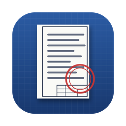

<p align="center">
  
</p>

<h1 align="center">Оттиск</h1>

<p align="center">
  Удобная печать для учёбы и работы: пресеты ГОСТ для курсовых, честное превью «как напечатается»
  и правильная ручная двусторонняя печать на принтерах, которые сами так не умеют.
</p>

<p align="center">
  <a href="https://github.com/ilyakhudoeshkogit/ottisk/releases/latest"></a>
  
  
  <a href="https://github.com/ilyakhudoeshkogit/ottisk/actions/workflows/ci.yml"></a>
  <a href="LICENSE"></a>
</p>

<p align="center">
  <a href="https://github.com/ilyakhudoeshkogit/ottisk/releases/latest"><b>⬇ Скачать последнюю версию</b></a>
</p>

---

## Что умеет

- **Превью «Как напечатается».** Видно ровно тот лист, который выйдет из принтера: поля, номера страниц, водяной знак, несколько страниц на листе.
- **Пресеты для учёбы.** Курсовая по ГОСТ 7.32 (поля 30/15/20/20 мм, место под дырокол, титул без номера), на Mac также БГУИР СТП, рамка ЕСКД, конспект, брошюра, экономия бумаги.
- **Двусторонняя печать вручную, но правильно.** Сначала все лицевые стороны, потом подсказка с картинкой, как перевернуть пачку, и оборотные стороны в нужном порядке. Пробный лист помогает один раз всё настроить.
- **Настройки, которые обычно спрятаны:** обрезка белых полей исходника, поле под переплёт, нумерация с любого числа, водяной знак «ЧЕРНОВИК / КОПИЯ», чётные и нечётные страницы, брошюра.
- **Ничего не меняет в оригинале.** Оттиск печатает свою копию, исходный файл не трогается.

| | macOS | Windows |
|---|---|---|
| Файлы | PDF, картинки, текст, DOCX/RTF/ODT | PDF, JPG/PNG/BMP/GIF/TIFF |
| Как печатает | через CUPS (`lp`), драйвер не заменяется | через системную печать Windows |
| Очередь из нескольких документов | есть | нет |
| Сканер | есть (ImageCaptureCore) | нет |
| Интерфейс | полный, ru/en | крупный и простой, ru |

## Установка

### Windows 10 и 11

1. Скачай `Ottisk-Setup-<версия>.exe` со страницы [Releases](https://github.com/ilyakhudoeshkogit/ottisk/releases/latest) и запусти.
2. Если появится «Windows защитила ваш компьютер», нажми **«Подробнее» → «Выполнить в любом случае»**. Это предупреждение SmartScreen: у программы нет платной цифровой подписи.
3. Права администратора и .NET не нужны. Ярлыки появятся на рабочем столе и в меню «Пуск». Новая версия ставится поверх старой, настройки сохраняются.

Без установки: `Ottisk-Windows-portable-<версия>.exe` запускается сразу.
Подробная инструкция для пользователя: [windows/docs/ИНСТРУКЦИЯ.md](windows/docs/ИНСТРУКЦИЯ.md).

### macOS 14 Sonoma и новее

1. Скачай `Ottisk-macOS-<версия>.dmg` (или `.zip`) со страницы [Releases](https://github.com/ilyakhudoeshkogit/ottisk/releases/latest) и перетащи **Оттиск** в «Программы».
2. Приложение подписано ad-hoc, без платного аккаунта Apple Developer, поэтому macOS при первом запуске его не пустит:
   - **macOS 15 и новее:** попробуй открыть, затем «Системные настройки → Конфиденциальность и безопасность» → внизу **«Всё равно открыть»**;
   - **macOS 14:** правый клик по приложению → **«Открыть»** → «Открыть»;
   - или в Терминале: `xattr -dr com.apple.quarantine /Applications/Ottisk.app`.

Собрать самому (нужны только Command Line Tools, Xcode не нужен):

```bash
git clone https://github.com/ilyakhudoeshkogit/ottisk.git
cd ottisk/macos
./build-app.sh --install --open
```

## Структура репозитория

- [`macos/`](macos): Swift Package, логика в `OttiskCore` (с тестами, идут и на Linux), приложение на SwiftUI + PDFKit. Подробно в [macos/README.md](macos/README.md).
- [`windows/`](windows): .NET 8, логика в `Ottisk.Core` (xUnit-тесты), приложение на WPF, установщик NSIS. Подробно в [windows/README.md](windows/README.md).
- [`.github/workflows/`](.github/workflows): GitHub Actions. `ci.yml` на каждый push и PR прогоняет тесты и собирает Mac-версию только Command Line Tools; `release.yml` по тегу `v*` собирает обе версии и прикладывает их к релизу. Подробно в [ci/README.md](ci/README.md).

Версии и изменения: [CHANGELOG.md](CHANGELOG.md).

## Что проверено, а что нет

Честно: логика раскладки, порядка двусторонней печати и диапазонов покрыта тестами (106 на Swift, 131 на C#).
Mac-версии 0.3–0.4 собирались и запускались на настоящем Mac, 0.5–0.6 там ещё не компилировались. Windows-версия собирается кросс-сборкой,
но на живой Windows и с реальным принтером ещё не проверялась. Если что-то не так, открой [issue](https://github.com/ilyakhudoeshkogit/ottisk/issues).

---

## English

**Ottisk** is a small printing app for macOS 14+ and Windows 10/11, made for students and office work:
a true "as it will print" preview, Russian GOST thesis presets (margins for a hole punch, page numbers without one on the title page),
and a proper manual duplex mode for printers without automatic duplex (fronts first, a picture of how to flip the stack, then backs in the right order).

Download the latest build from [Releases](https://github.com/ilyakhudoeshkogit/ottisk/releases/latest).
The apps are not notarized or code-signed with a paid certificate: on Windows click *More info → Run anyway* in SmartScreen;
on macOS right-click the app → *Open*, or run `xattr -dr com.apple.quarantine /Applications/Ottisk.app`.
The interface is Russian (the macOS version also has English). License: [MIT](LICENSE).
